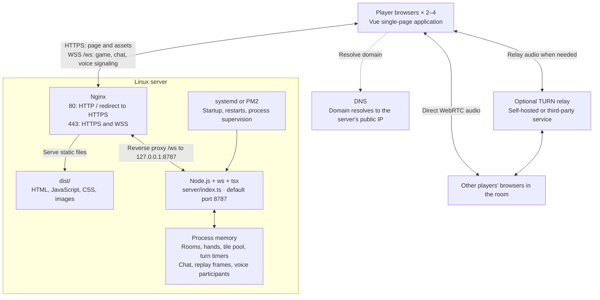
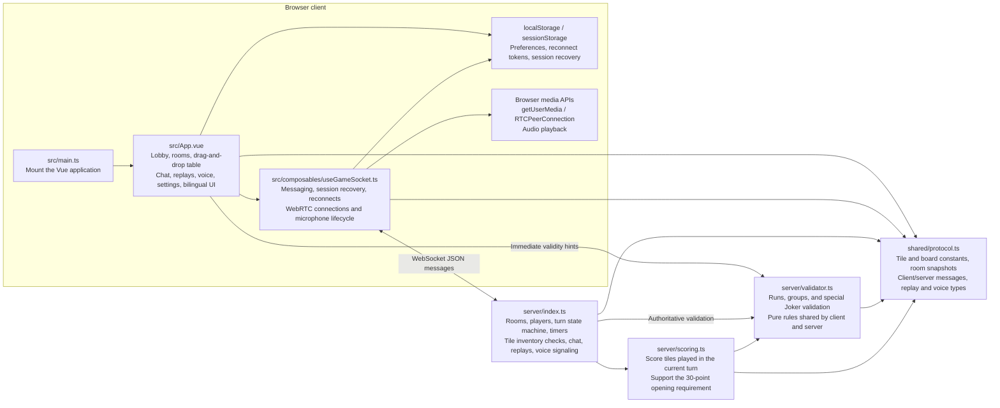
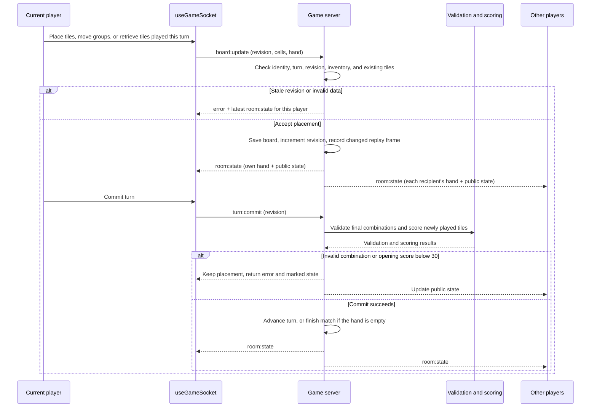
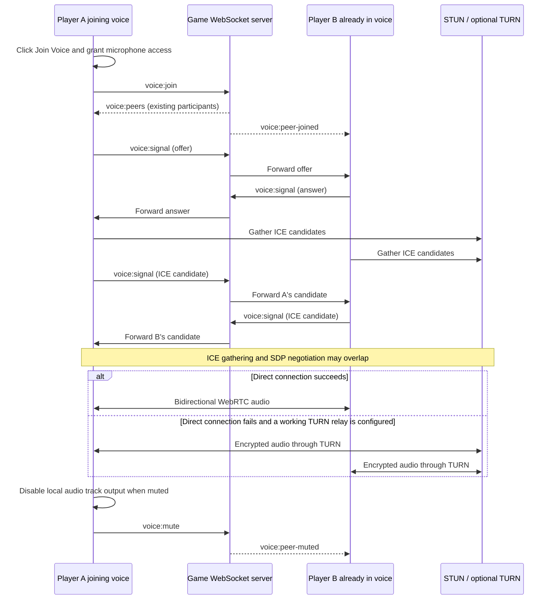
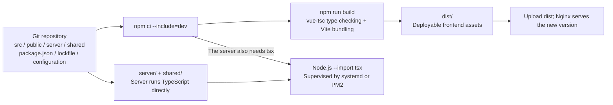

# RummikubTwist

[中文](README.md) | [English](README.en.md)

A multiplayer Rummikub prototype built with Vue 3 and a lightweight Node.js WebSocket server, featuring special Jokers, room voice chat, and match replays.

## Architecture

The project consists of a Vue single-page client, an authoritative Node.js game server, and WebRTC room voice chat. Clients submit actions; the server owns room state and determines the outcome. Game actions, text chat, replay requests, and voice signaling share one WebSocket connection.

### 1. Runtime and deployment

This diagram shows an HTTPS production deployment. The repository's Nginx template starts with HTTP; configure the domain and TLS certificate on the deployment server.



- Nginx serves the frontend assets and proxies WebSocket connections. The Node.js server does not currently serve frontend files.
- Public web access normally needs ports 80/443. Restrict port 8787 to internal access with firewall rules. The Node.js server does not specify a bind address, so it does not automatically listen only on the loopback interface.
- Audio does not pass through Nginx or the game WebSocket server. If you use TURN, also configure the relay's listening and media ports.
- Rooms are stored in an in-memory `Map`. There is no database, Redis, disk persistence, or room synchronization between processes. Restarting the game server clears matches, chat, and replays. The current design supports a single game server instance.

### 2. Modules and dependencies

Arrows mean “imports or uses.” The storage node represents browser persistence.



| Path | Responsibility |
| --- | --- |
| [`src/App.vue`](src/App.vue) | Main interactions, table animations, settings, results, and replay UI |
| [`src/composables/useGameSocket.ts`](src/composables/useGameSocket.ts) | Game connection state, session recovery, and voice connections |
| [`shared/protocol.ts`](shared/protocol.ts) | Shared message types and data structures; not a separate running service |
| [`server/index.ts`](server/index.ts) | Single-process authoritative game server and WebSocket message dispatch |
| [`server/validator.ts`](server/validator.ts), [`server/scoring.ts`](server/scoring.ts) | Rule validation and scoring |
| [`public/`](public/), [`src/assets/`](src/assets/) | Backgrounds, icons, and images |
| [`deploy/`](deploy/), [`ecosystem.config.cjs`](ecosystem.config.cjs) | Nginx, systemd, and PM2 deployment templates |
| [`server/validator-test.ts`](server/validator-test.ts), [`server/smoke-test.ts`](server/smoke-test.ts) | Rule tests and game / voice signaling integration tests |

### 3. Game actions and state synchronization

Rooms move through `WAITING → PLAYING → FINISHED`. After a match, the host can return the room to the waiting state and start again. The server uses `revision` to reject actions based on stale state and creates a separate snapshot for each player. During a match, a player receives their own full hand; other players' hands are represented only by tile counts.



While tiles are being arranged, the server checks the data and tile inventory. It validates complete combinations when the turn is committed; client-side hints assist the player. The server also handles drawing, reverting, turn timeouts, and win detection. A disconnected player's seat is reserved for 60 seconds, and the client uses `roomId + reconnectToken` to recover it. Full replays are available through `replay:request` only after the match ends and include every player's hand at each recorded frame.

### 4. Voice signaling and audio transport

Voice chat uses a mesh of peer-to-peer connections within the room: each participant connects to every other voice participant. With four participants, there are up to six bidirectional connections. There is currently no central mixer or SFU media server.



Public microphone access requires HTTPS; signaling uses WSS with the page. The default STUN server is `stun:stun.l.google.com:19302`. It discovers connection candidates and does not relay audio. Strict NAT or restricted networks may require TURN. Appearing in the voice roster means a player has joined, not that media transport has necessarily succeeded. Test real calls with two devices on different networks.

### 5. Build and update flow



Frontend build output is not committed to Git. The server currently has no separate JavaScript compilation step; `check:server` performs type checking only. When changing the shared protocol, update the frontend assets, `server/`, and `shared/` together to avoid mixing incompatible message formats.

## User flow

- Create a room or enter a six-character code to join a 2–4 player match.
- Move from the lobby to a waiting room, then to the game table and final results.
- Customize your nickname, animations, sound effects, high-contrast tiles, backgrounds, and Ice Blue or Arcade theme. Preferences are saved locally. The Arcade theme uses lightly rounded rectangles, matte acrylic edges, and physical press feedback.
- Switch between Chinese and English from the top bar. The selection is saved locally; the lobby, rooms, table, chat, rules, and developer tools have bilingual labels and layout adjustments.
- The table uses a raised frame around a recessed grid; both animate as the board expands or contracts.
- Refresh to recover a room session. Unexpected disconnections trigger automatic retries, with the server reserving the seat for 60 seconds.
- The host starts the match and can request another round after the results.
- The in-game DEV panel can add test tiles by color, number, or Joker type and displays the score of tiles played during the current turn.

## Local development

Use Node.js 22.12 or a newer supported version for the build environment. After cloning, install all dependencies:

```bash
npm ci --include=dev
```

Start the game server in one terminal:

```bash
npm run dev:server
```

Start the frontend in another:

```bash
npm run dev
```

The server listens at `ws://localhost:8787` by default. Set `VITE_WS_URL` to override the client endpoint, or `WS_PORT` to change the server's listening port.

## Implemented features and rules

- Six-character room codes, up to four players per room, and a minimum of two connected players for the host to start.
- Real-time room membership and current-turn updates.
- Server-broadcast text chat with the latest 60 messages retained.
- Opt-in WebRTC voice chat with joining, muting, leaving, participant status, and reconnection. Audio travels directly between browsers or through a configured TURN relay; the game WebSocket server handles signaling only.
- Server-generated, shuffled deck: two copies of numbers 1–13 in four colors, plus four special Jokers, for 108 tiles total.
- Each player starts with 14 private tiles; the remaining tiles form the shared pool.
- Only the current player can modify the table or end the turn.
- The server broadcasts authoritative board state after placing, moving, or retrieving tiles.
- Remote tile movements animate smoothly. Local placement follows the pointer immediately, the source ghost fades, and rejected drops animate back.
- Holding a table tile for about half a second picks up its contiguous right-hand chain. The whole chain returns if any destination cell is occupied.
- The board starts at 16 columns × 6 rows. Placing tiles at an edge expands it in that direction, up to 21 columns × 11 rows; empty edges shrink automatically.
- The frame, grid, and tiles scale together smoothly. Table and rack tiles always use the same size.
- The rack has a two-dimensional snap grid with two visible rows of 16 cells; extra tiles add independently scrollable rows.
- Rack tiles can leave gaps or be sorted by number or color to remove gaps.
- Revision checks prevent stale client actions from overwriting newer state.
- The server verifies tile IDs, counts, colors, values, and Joker types.
- The opening meld requires at least 30 points from tiles played from the current player's hand, totaled across valid final combinations. Existing table tiles may be rearranged but do not contribute to that score.
- Jokers score the number they represent in the final combination: for example, the Joker in `4-5-6-Joker` is worth 7 points.
- Mirror always scores 0, regardless of the valid combination it belongs to.
- Final combination validation runs on turn submission. Invalid or unfinished groups remain in place and are highlighted for correction.
- Tiles already on the table at the start of a turn cannot return to the rack; only tiles played from the player's hand during that turn can be retrieved.
- Color Change is allowed only in runs, including at either end. If tiles follow it, the color changes starting with the next tile.
- A player may abandon the turn's changes and draw one tile, automatically advancing the turn.
- Valid submission advances the turn. Emptying a hand wins and ends the match.
- Player disconnections update membership and turn state; empty rooms are released automatically.

## Verification and deployment updates

Before running `test:ws`, start `npm run dev:server` in another terminal. The test covers game flow and voice signaling; microphone access and actual audio across networks must be tested in a browser.

```bash
npm run check:server
npm run test:validator
npm run test:ws
npm run build
```

The repository contains the full source, dependency lockfile, and deployment templates. It excludes `node_modules/`, `dist/`, logs, and deployment archives. Run `npm run build` to regenerate `dist/` from the current source.

For an existing Nginx + systemd deployment, upload matching versions of `dist/`, `server/`, and `shared/`, then restart the `rummikub` service. If dependencies changed, also upload `package.json` and `package-lock.json` and run `npm ci --include=dev` on the server. The server currently needs `tsx` at runtime, so do not omit development dependencies. Frontend-only changes require replacing the complete `dist/` directory without a service restart. Restarting the game server clears in-memory rooms and matches. Adapt the templates in `deploy/` to your actual paths and domain.

## Voice deployment and configuration

On `localhost`, browsers can request microphone access directly. Public deployments must use HTTPS for the page and WSS for the game connection.

| Variable | When it takes effect | Purpose |
| --- | --- | --- |
| `WS_PORT` | Node.js server startup | WebSocket listening port; defaults to `8787` |
| `VITE_WS_URL` | Frontend build | Override the WebSocket endpoint. Without it, development connects to port `8787` on the page's host; production connects to the same origin at `/ws`, automatically using WSS on HTTPS pages |
| `VITE_TURN_URL` | Frontend build | Optional TURN relay URL |
| `VITE_TURN_USERNAME` | Frontend build | TURN username |
| `VITE_TURN_CREDENTIAL` | Frontend build | TURN access credential |

`VITE_*` values are embedded in the assets sent to browsers. After changing them, rebuild and upload `dist/`; restarting systemd alone will not update these values. TURN credentials are visible to clients and must not be treated as private server-side secrets.

Voice uses STUN for direct connections by default. Configure a TURN relay for more reliable connectivity through strict NAT, campus networks, or some mobile networks:

```env
VITE_TURN_URL=turn:turn.example.com:3478
VITE_TURN_USERNAME=your-username
VITE_TURN_CREDENTIAL=your-credential
```

Without TURN, direct connections can work on localhost and ordinary networks, but some combinations of networks may prevent participants from hearing each other.
