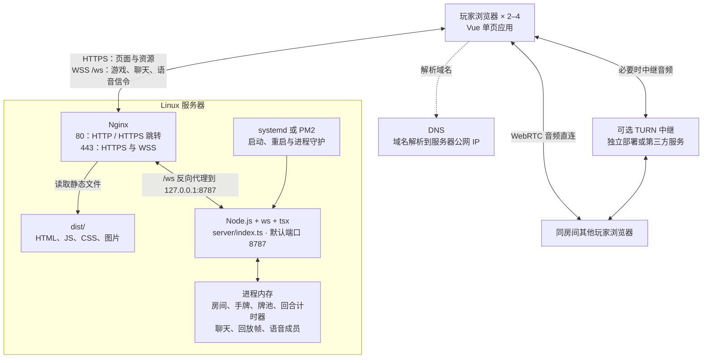
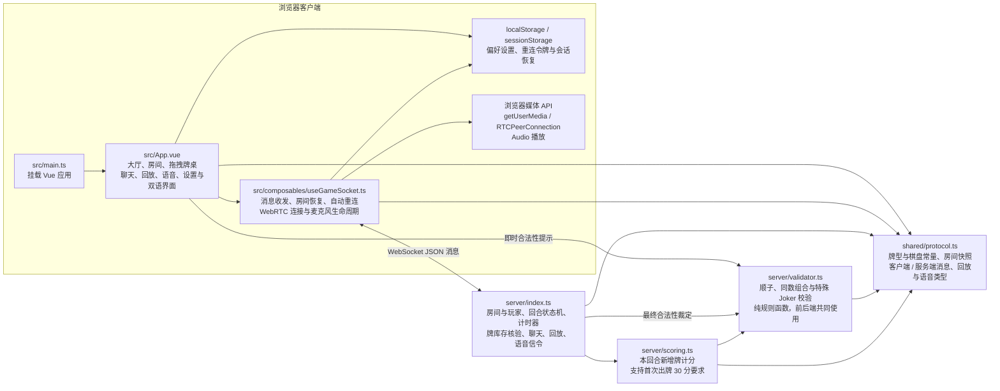
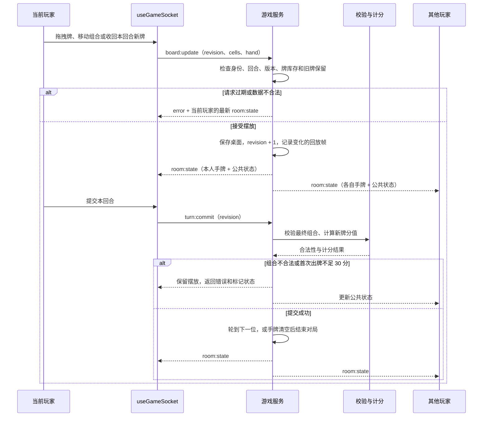
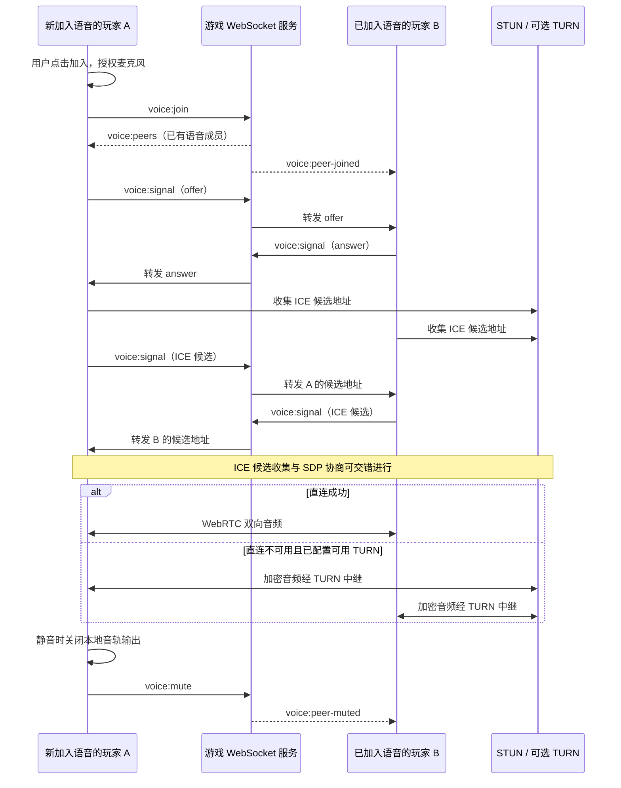
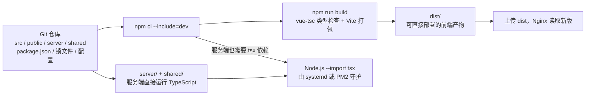

# RummikubTwist

[中文](README.md) | [English](README.en.md)

Vue 3 客户端与轻量 Node.js WebSocket 服务端组成的多人拉密原型。

## 项目架构

项目由 Vue 单页客户端、Node.js 权威游戏服务和 WebRTC 房间语音组成。客户端提交操作，服务端维护房间状态并裁定结果；聊天、回放请求和语音信令复用同一条 WebSocket 连接。

### 1. 运行与部署

下面是 HTTPS 生产部署结构；仓库中的 Nginx 模板提供 HTTP 起点，域名与 TLS 证书需要在实际服务器上配置。



- Nginx 提供静态页面并代理 WebSocket；Node.js 当前不提供前端静态资源服务。
- 公网入口通常只需开放 80/443，8787 应通过防火墙限制为服务器内部访问。当前 Node 服务没有指定监听地址，不会自动只绑定回环地址。
- 音频不经过 Nginx 或游戏 WebSocket 服务。若使用 TURN，还需要按中继服务的配置开放其监听与媒体端口。
- 房间状态保存在 `Map` 中，目前没有数据库、Redis、磁盘持久化或跨进程房间同步。服务端重启会清空对局、聊天与回放；当前适合运行一个游戏服务实例。

### 2. 代码模块与依赖

图中箭头表示“导入或使用”，存储节点表示浏览器持久化。



| 路径 | 职责 |
| --- | --- |
| [`src/App.vue`](src/App.vue) | 主要交互、牌桌动画、设置、结算和回放界面 |
| [`src/composables/useGameSocket.ts`](src/composables/useGameSocket.ts) | 游戏网络状态、断线恢复及语音连接 |
| [`shared/protocol.ts`](shared/protocol.ts) | 前后端共同使用的消息类型和数据结构；不是独立运行的服务 |
| [`server/index.ts`](server/index.ts) | 单进程权威游戏服务与 WebSocket 消息分发 |
| [`server/validator.ts`](server/validator.ts)、[`server/scoring.ts`](server/scoring.ts) | 规则校验与计分 |
| [`public/`](public/)、[`src/assets/`](src/assets/) | 背景、图标及图片资源 |
| [`deploy/`](deploy/)、[`ecosystem.config.cjs`](ecosystem.config.cjs) | Nginx、systemd 与 PM2 部署模板 |
| [`server/validator-test.ts`](server/validator-test.ts)、[`server/smoke-test.ts`](server/smoke-test.ts) | 规则测试与游戏 / 语音信令集成测试 |

### 3. 游戏操作与状态同步

房间按 `WAITING → PLAYING → FINISHED` 流转，房主可以在结束后请求回到等待状态再开一局。服务端使用 `revision` 拒绝基于过期状态的修改，并为每位玩家分别生成快照：对局中发送该玩家的完整手牌，其他玩家只公开手牌数量。



摆牌阶段先核对数据和牌库存，完整组合是否合法在提交时统一裁定；前端提示用于辅助操作。服务端同时处理摸牌、撤回、回合超时及胜负判定。断线后保留席位 60 秒，客户端凭 `roomId + reconnectToken` 恢复连接；完整回放仅在对局结束后通过 `replay:request` 获取，包含各玩家当时的手牌。

### 4. 语音信令与音频传输

语音使用房间内的多方点对点连接：每位加入语音的玩家分别连接其他语音成员。四人全员加入时最多形成六条双向连接，目前没有集中混音或 SFU 媒体服务。



公网麦克风访问需要 HTTPS，信令随页面使用 WSS。默认 STUN 地址为 `stun:stun.l.google.com:19302`；它用于发现连接候选地址，不负责转发音频。严格 NAT 或受限网络可能需要 TURN。语音成员列表显示已加入，不代表媒体连接一定成功；真实通话仍需两台设备在不同网络下验证。

### 5. 构建与更新



前端产物不提交 Git。服务端目前没有单独编译为 JavaScript 的构建步骤，`check:server` 只进行类型检查。修改共享协议时应一起更新前端产物、`server/` 与 `shared/`，避免不同版本的消息结构混用。

## 当前流程

- 简洁的在线大厅，可创建或凭 6 位代码加入 2–4 人房间
- 等待房间、玩家席位、房间号复制、完整对局与胜利排名页面
- 设置浮窗支持昵称、动效、音效、高对比牌面、背景纹理及冰蓝、竞技街机两套主题，并保存在本地；竞技主题采用普通微圆角矩形、四面等厚的哑光亚克力边面与实体按压反馈
- 顶栏可即时切换中文与英文，设置会本地保存；大厅、房间、牌桌、聊天、玩法和开发者工具均提供双语文案与对应尺寸适配
- 牌桌使用独立的凸起画框包裹内凹网格，网格扩缩时画框会同步平滑调整尺寸
- 刷新页面自动恢复房间；意外断线后自动重试，服务端保留玩家席位 60 秒
- 房主可开始游戏，并在结算后发起再来一局
- 对局右上角 DEV 测试台可按颜色、数字或 Joker 类型发放测试牌，并显示本回合新增牌总分

## 本地启动

构建环境使用 Node.js 22.12 或更新的受支持版本。首次克隆后先安装完整依赖：

```bash
npm ci --include=dev
```

分别打开两个终端：

```bash
npm run dev:server
```

```bash
npm run dev
```

服务端默认监听 `ws://localhost:8787`。如果需要修改地址，可在客户端设置
`VITE_WS_URL`，或在服务端设置 `WS_PORT`。

## 当前已实现

- 创建六位房间号、最多四名玩家加入；房主在至少两人时开始游戏。
- 房间玩家列表与当前回合实时广播。
- 对局内置右侧实时聊天面板，消息由服务端广播并保留最近 60 条。
- 房间内置 WebRTC 语音聊天，支持主动加入、静音、退出、成员状态及断线重连；声音直接在玩家浏览器之间传输，现有 WebSocket 服务只转发连接信息。
- 服务端生成并洗牌：两套四色 1–13 加四种特殊 Joker，共 108 张。
- 开局每名玩家获得 14 张私有手牌，其余牌进入公共牌池。
- 只有当前玩家能修改桌面或结束回合。
- 每次落牌、移动或收牌后，服务端广播完整权威桌面状态。
- 其他玩家收到广播时牌会平滑移动；操作方落牌立即跟手，原位置虚影快速淡出，失败落点则平滑回弹。
- 按住桌面牌约半秒会连同它右侧连续相邻的牌一起拿起；目标区域任一格被占用时整组回弹。
- 基础牌桌为 16×6；在边缘落牌会向对应方向扩展，最大为 21×11，空边缘在牌被移走后自动收回。
- 扩缩牌桌时，牌桌框、格子与所有牌平滑等比例缩放，桌面牌和手牌始终使用同一尺寸。
- 手牌区提供两行可见的二维吸附网格，每行 16 格；更多手牌会增加独立行并允许纵向滚动。
- 手牌可自由留空摆放，也可按数字优先或颜色优先一键排序并清除空隙。
- 使用 revision 防止旧消息覆盖新状态。
- 服务端核对牌的唯一 ID、数量、颜色、数字与 Joker 类型。
- 首次出牌按本回合从手牌加入最终合法组合的牌跨组合累计；允许重排旧桌面牌，但旧牌不计分。
- Joker 按它在最终组合中代表的实际数字计分，例如 `4-5-6-Joker` 中 Joker 为 7 分。
- Mirror 无论处于哪种合法组合中都固定计 0 分。
- 组合合法性只在提交时由服务端统一校验；不合法和未完成组合保留原摆法，并以红框提示继续修改。
- 回合开始前已经在桌面的牌不能收入手牌；只有本回合从自己手牌打出的牌可以拿回。
- Color Change 只允许用于 run，可位于开头或末尾；右侧有牌时必须从下一张开始换色。
- 首次出牌可重排桌面旧牌，但至少 30 分只累计本回合从自己手牌打入最终合法组合的牌。
- 玩家可以放弃本回合改动并摸一张牌，随后自动轮转。
- 合法提交后轮转；手牌清空后服务端宣布获胜并结束游戏。
- 玩家断开时更新房间成员和当前回合，空房间自动释放。

## 检查

`test:ws` 需要先在另一个终端启动 `npm run dev:server`，它会检查游戏流程及语音信令；实际麦克风和跨网络语音需要在浏览器中测试。

```bash
npm run check:server
npm run test:validator
npm run test:ws
npm run build
```

仓库保存完整源码、锁文件和部署模板；`node_modules/`、`dist/`、日志及部署压缩包不提交。`npm run build` 会从当前源码重新生成 `dist/`。

已有 Nginx + systemd 部署更新时，将同一版本的 `dist/`、`server/`、`shared/` 一起上传，并重启 `rummikub` 服务。依赖变化时还需同步 `package.json` 和 `package-lock.json`，在服务器运行 `npm ci --include=dev`；当前服务端通过 `tsx` 启动，因此不能省略开发依赖。前端单独更新只需替换整个 `dist/`。服务端重启会清空内存中的房间与对局。`deploy/` 中是部署模板，需按实际路径和域名配置。

## 语音部署

本地 `localhost` 可以直接申请麦克风权限。上传到公网时，页面必须使用 HTTPS，WebSocket 也应通过 WSS 连接。

| 变量 | 生效阶段 | 用途 |
| --- | --- | --- |
| `WS_PORT` | Node.js 服务启动时 | WebSocket 监听端口，默认 `8787` |
| `VITE_WS_URL` | 前端构建时 | 覆盖 WebSocket 地址；不设置时，开发环境连接页面主机的 `8787`，生产环境连接同源 `/ws`，并随 HTTPS 自动使用 WSS |
| `VITE_TURN_URL` | 前端构建时 | 可选 TURN 中继地址 |
| `VITE_TURN_USERNAME` | 前端构建时 | TURN 用户名 |
| `VITE_TURN_CREDENTIAL` | 前端构建时 | TURN 访问凭据 |

`VITE_*` 配置会写进浏览器收到的构建文件；修改后必须重新构建并上传 `dist/`，只重启 systemd 不会更新这些值。TURN 凭据在客户端可见，不能作为服务端私密凭据保存。

语音默认使用 STUN 建立玩家间直连。为了让严格 NAT、校园网或部分移动网络下的玩家也能稳定加入，生产环境建议配置 TURN 中继：

```env
VITE_TURN_URL=turn:turn.example.com:3478
VITE_TURN_USERNAME=your-username
VITE_TURN_CREDENTIAL=your-credential
```

没有配置 TURN 时不影响本地和大多数普通网络下的使用，但少数网络组合可能无法互相听见。
